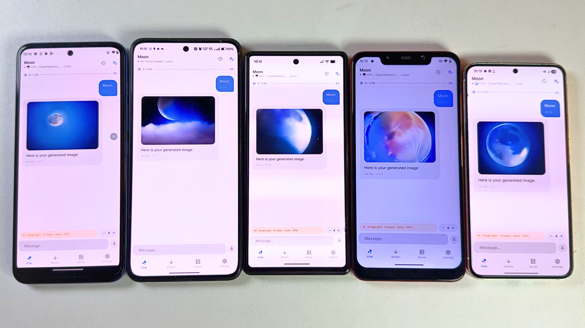

# OpenLM

[](https://flutter.dev)
[](https://github.com/ggerganov/llama.cpp)
[](./LICENSE)

**OpenLM** is a privacy-first, cross-platform AI client and distributed inference engine. It runs local GGUF models directly on laptops, desktops, and phones with native hardware acceleration, while allowing you to **pool memory across multiple devices** (Windows, macOS, Linux, Android, iOS) into a single distributed cluster to load and chat with large models that wouldn't fit on any single device alone.


_Cross-platform local inference and on-device generation across desktop and mobile hardware._

---

## Key Capabilities

### 1. Unified Desktop & Mobile Application
- **All-in-One Experience:** The interactive chat UI and the high-performance local inference engine live together in a single application. No separate CLI backend, Docker container, or daemon required.
- **Full Cross-Platform Support:** Native binaries for **Windows (x64)**, **macOS (Apple Silicon & Intel)**, **Linux (x64/ARM64)**, **Android**, and **iOS / iPadOS**.
- **Hardware Acceleration:**
  - **macOS & iOS:** Metal GPU acceleration.
  - **Android & Linux:** Vulkan GPU acceleration and ARM NEON / AVX2 CPU paths.
  - **Windows:** Native multi-threaded CPU SIMD (AVX2 / AVX-512) and GPU offload.

### 2. Multi-Device Cluster (`ggml-rpc`)
Pool your laptops, desktops, tablets, and phones to load big models (e.g., 14B, 32B, 70B) together:
- **Master & Worker Roles:** Any device (laptop, desktop, or mobile) can serve as the **Master** orchestrator or join as a **Worker**.
- **Dynamic Layer Splitting:** The Master measures each worker's available RAM and network throughput, automatically offloading model layers proportionally across the cluster.
- **Zero-Friction Discovery:**
  - **LAN UDP Beaconing:** Automatic worker discovery on port `50053` across Wi-Fi and Ethernet.
  - **Apple Bonjour / mDNS:** Automatic peer discovery on Apple devices (`_openlm._tcp`).
  - **QR Code & Clipboard Links:** 1-tap connection via `openlm://worker?host=...&port=...` or standard IP input.

### 3. Local Multimodal & Image Generation
- **Vision Support:** Send images and analyze them with vision-language models (e.g., Qwen2-VL) locally or via cloud models.
- **Local Image Generation:** Generate images locally using on-device Stable Diffusion (`sd_flutter_android`).

### 4. Built-in OpenAI-Compatible API Server
- Run a local HTTP server directly inside OpenLM conforming to the OpenAI `/v1/chat/completions` specification.
- Expose your local models or cluster to external developer tools, IDE extensions (Cursor, VS Code, Continue), and third-party Web UIs with optional token authorization and loopback binding.

### 5. Multi-Provider Cloud Fallback
- Seamlessly toggle from local inference to cloud providers when on low-memory hardware or when extra reasoning power is required:
  - **OpenAI** (GPT-4o, o1, o3-mini)
  - **Anthropic Claude** (Claude 3.5 Sonnet, Claude 3.7 Sonnet)
  - **Google Gemini** (Gemini 2.0 Flash, Gemini 1.5 Pro)
  - **Kimi / Moonshot AI** (Moonshot Chat)
- All cloud API keys are kept safely in local encrypted storage and transmitted directly to the respective provider.

### 6. Privacy First & Auto-Configuration
- **100% Offline Capability:** After downloading GGUF weights, local inference runs completely air-gapped without network requests.
- **Smart Hardware Detection:** OpenLM inspects system RAM and processor architecture on startup, auto-tuning context size, thread allocations, and token limits.
- **Local Persistence:** Chat histories, settings, and session trees are stored locally via Hive.

---

## Supported Platforms

| Platform | Local GGUF Inference | Cluster Master | Cluster Worker | Hardware Acceleration |
| :--- | :---: | :---: | :---: | :--- |
| **Windows** | ✅ Yes | ✅ Yes | ✅ Yes | CPU SIMD (AVX2/AVX-512) & GPU |
| **macOS** | ✅ Yes | ✅ Yes | ✅ Yes | Apple Silicon Metal GPU |
| **Linux** | ✅ Yes | ✅ Yes | ✅ Yes | Vulkan GPU & CPU SIMD |
| **Android** | ✅ Yes | ✅ Yes | ✅ Yes | Vulkan GPU & ARM NEON (minSdk 28) |
| **iOS / iPadOS** | ✅ Yes | ✅ Yes | ✅ Yes | Metal GPU acceleration |
| **Web** | ❌ (Cloud only) | ❌ | ❌ | WebAssembly cloud client |

---

## Technical Architecture

```
┌─────────────────────────────────────────────────────────────┐
│                        UI Layer                              │
│   ChatView · ClusterView · ServerView · SettingsView        │
└──────────────────────────┬──────────────────────────────────┘
                           │
┌──────────────────────────▼──────────────────────────────────┐
│                    Controllers (GetX)                        │
│   ChatController · ModelController · SettingsController     │
│   ClusterController · ServerController · HomeController     │
└──────────────────────────┬──────────────────────────────────┘
                           │
┌──────────────────────────▼──────────────────────────────────┐
│                      Core Services                           │
│  ┌──────────────────┐  ┌──────────────────┐  ┌────────────┐ │
│  │ InferenceService │  │  ClusterService  │  │CloudService│ │
│  │   (Local GGUF)   │  │ (Master/Worker)  │  │ (Cloud API)│ │
│  └─────────┬────────┘  └─────────┬────────┘  └────────────┘ │
│            │                     │                          │
│  ┌─────────▼────────┐  ┌─────────▼────────┐  ┌────────────┐ │
│  │ OpenAiServerSvc  │  │  DeviceInfoSvc   │  │ HiveService│ │
│  │(Local API Server)│  │ (RAM/GPU Tiers)  │  │(Local Data)│ │
│  └──────────────────┘  └──────────────────┘  └────────────┘ │
└──────────────────────────┬──────────────────────────────────┘
                           │
┌──────────────────────────▼──────────────────────────────────┐
│                 Native llama.cpp Engine                     │
│  ┌───────────────────────────────────────────────────────┐  │
│  │ Windows & Linux: llama_desktop_core.cpp (RPC/Sampling)│  │
│  │ macOS & iOS:     Metal LlamaIosWrapper / ClusterWorker│  │
│  │ Android:         JNI Vulkan / ARM64 NEON Wrapper      │  │
│  └───────────────────────────────────────────────────────┘  │
└─────────────────────────────────────────────────────────────┘
```

---

## How Clustering Works

When loading a large model that exceeds the VRAM or RAM of a single computer or phone:

1. **Start Workers:** Open OpenLM on one or more secondary devices (e.g. an iPhone, iPad, Android tablet, or spare laptop), navigate to **Device Cluster**, and turn **Worker** to `On`.
2. **Discover or Pair:** On the primary **Master** device (e.g. your main laptop):
   - The master scans for LAN beacons (UDP port `50053`) and Bonjour services (`_openlm._tcp`) automatically.
   - Alternatively, scan the worker's displayed QR code or copy and paste the worker link (`openlm://worker?host=...&port=...`).
3. **Load Model:** Select your GGUF model on the Master. OpenLM automatically splits and maps the neural network layers across the worker pool and streams inference tokens back in real-time.

---

## Building from Source

### Prerequisites
- **Flutter SDK:** >= 3.3.0 (`channel stable`)
- **Dart SDK:** >= 3.3.0
- **C++ Compiler:**
  - **Windows:** Visual Studio 2022 with Desktop C++ workload and CMake
  - **macOS:** Xcode 15+ and Command Line Tools
  - **Linux:** `build-essential`, `cmake`, `libgtk-3-dev`, `pkg-config`
  - **Android:** Android SDK (API 28+), NDK, and JDK 17
  - **iOS:** Xcode with iOS deployment target 16.0+

### Setup

```bash
# Clone the repository
git clone https://github.com/your-username/openlm.git
cd openlm

# Fetch dependencies
flutter pub get
```

### Desktop Builds

#### Windows
```bash
flutter build windows --release
```
The output executable is generated at `build/windows/x64/runner/Release/openlm.exe`.

#### Linux
```bash
flutter build linux --release
```
The output bundle is generated at `build/linux/x64/release/bundle/`.

#### macOS (via Xcode or CLI)
You can build the macOS app directly using Flutter or open the project in Xcode:

**Method 1 — Terminal / CLI:**
```bash
flutter pub get
cd macos && pod install && cd ..
flutter build macos --release
```
Your standalone macOS app bundle will be ready at:  
`build/macos/Build/Products/Release/OpenLM.app`. You can double-click it or drag it to your `/Applications` folder.

**Method 2 — Xcode GUI:**
```bash
open macos/Runner.xcworkspace
```
1. In Xcode's top toolbar, set the run destination to **My Mac**.
2. Select **Product > Build** (`Cmd + B`) to build, or **Product > Run** (`Cmd + R`) to launch with debugging.

---

### Mobile Builds

#### Android (APKs)
```bash
# Debug APK
flutter build apk --debug

# Production Split-ABI APKs
flutter build apk --release --split-per-abi
```
The output APKs are located at `build/app/outputs/flutter-apk/`.

#### iOS / iPadOS (via Xcode or Sideloading)

To install OpenLM on your iPhone or iPad, you need a Mac with **Xcode** (available free from the Mac App Store) and CocoaPods (`brew install cocoapods`).

##### Method 1 — Direct USB Install to iPhone/iPad using Xcode (Free Apple ID)
You can install and run OpenLM on your personal devices without a paid Apple Developer Account:

1. **Install dependencies:**
   ```bash
   flutter pub get
   cd ios && pod install && cd ..
   ```
2. **Open the iOS workspace in Xcode:**
   ```bash
   open ios/Runner.xcworkspace
   ```
   *(Always open `.xcworkspace`, never `.xcodeproj`)*
3. **Configure Signing:**
   - In Xcode's left sidebar, click on the blue **Runner** project icon at the very top.
   - Select the **Runner** target, then click the **Signing & Capabilities** tab.
   - Check **"Automatically manage signing"**.
   - Under **Team**, select your name / personal Apple ID (e.g., `Your Name (Personal Team)`). If you haven't logged in, go to `Xcode > Settings > Accounts` and add your Apple ID with `+`.
   - Change the **Bundle Identifier** to a unique string for your account, for example: `com.yourname.openlm`.
4. **Connect Device & Run:**
   - Plug your iPhone or iPad into your Mac via USB cable (tap "Trust this computer" on your device if prompted).
   - In Xcode's top destination dropdown, select your connected iPhone or iPad.
   - Click the **Run** button (play icon or `Cmd + R`). Xcode will compile the Metal engine, link the frameworks, and install OpenLM onto your device.
5. **Trust the Developer Profile on your Device:**
   - On your iPhone/iPad, go to **Settings > General > VPN & Device Management**.
   - Tap your Apple ID under *Developer App* and tap **Trust**.
   - On iOS 16+, make sure **Developer Mode** is turned on in **Settings > Privacy & Security > Developer Mode** (requires a device restart).

##### Method 2 — Build Unsigned `.ipa` for AltStore / SideStore
If you prefer installing via AltStore, SideStore, or TrollStore:
```bash
flutter build ios --release --no-codesign
cd build/ios/iphoneos
mkdir -p Payload
cp -r Runner.app Payload/
zip -r ../../../OpenLM-iOS.ipa Payload
cd ../../..
```
Transfer the generated `OpenLM-iOS.ipa` to your device and open it in AltStore / SideStore to install.

---

## Quality Assurance & Tests

Run the full test suite and static analysis:

```bash
# Run unit & integration tests
flutter test

# Run analyzer
flutter analyze
```

---

## License

OpenLM is open-source software licensed under the [MIT License](./LICENSE).
